# Calls and meetings in teams-lite: where they stand, and the roadmap to finish them

**Read this page first.** It indexes nine workstream designs in this directory. Each design was
written and then put through two adversarial reviews on 2026-11-05. The sources are this worktree
at `c941850`, `NATIVE-CALLING.md` (the measured protocol map), the round-1 research (95 gaps and 87
open issues), and the Teams web client bundle fetched on 2026-11-05. Every file:line and bundle
snippet below was re-checked for this page.

Words used throughout: **measured** means the real tenant answered it through this app.
**Read-from-bundle** means the client's own code says so. **Inferred** means neither.

## 1. The honest answer

**teams-lite does have calls and meetings.** Audio calling is built and has been verified live:

- a meeting join, in which the user heard and was heard, on 2026-08-05;
- one-to-one calls in both directions with a colleague, on 2026-09-04.

What makes the feature look missing is three things:

- **The calling plane fails silently.** Above all, it never registers on any boot of the container
  image in its default embedded mode (finding 1). When that happens, every Call and Join control is
  drawn disabled.
- **An incoming call makes no sound** and is not reported when it ends elsewhere.
- **Video and meeting participation are not there:** no picture, no camera or screen send, no hands,
  no lobby admit.

| Area | Status | Evidence | Fixed or added by |
| --- | --- | --- | --- |
| Join a meeting from a calendar event or a link, with audio both ways | **Verified** 2026-08-05 | NATIVE-CALLING.md § 8 | — |
| Answer an incoming 1:1 (attach, then acceptance) | **Verified** 2026-09-04 | NATIVE-CALLING.md § 8a | — |
| Place a 1:1; End ends it for both people | **Verified** 2026-09-04 | NATIVE-CALLING.md § 8b | — |
| Calls ring on this machine (the calling registration) | **Works on the host service** (the 2026-09-04 call rang here); **broken on boot of the embedded image** | `src/bin/server.rs:15660-15669` | plane-reliability M1 |
| Join a meeting from its own chat (the thread address) | **Inferred, unmeasured.** The mode was added in `ebba7d9` (2026-08-05). A driver comment written in `253e33f` (2026-09-04) says `--from-chat` "is the mode that works here", but no NATIVE-CALLING.md entry records a thread-addressed join, and CLAUDE.md § Joining a meeting and ringing-alerts-history § 4.12 both call it unverified. | `web/scripts/join-live.ts:76-98` | Measure it in step 4 of § 4, then fix the doc |
| Receive a colleague's shared screen | **Broken.** The subscription is answered 200, then 0 bytes arrive. | NATIVE-CALLING.md:1672-1687 | video-receive |
| Send a camera or a screen | **Broken.** Every added section comes back with port 0. | NATIVE-CALLING.md § 10.8 | video-send |
| Ring a whole group chat (20 people at most) | Built, never run | `src/bin/server.rs:7505-7583` | — (live run is the user's own click) |
| Hang up an incoming call so the caller is told | Built, **unmeasured** (it falls through to `callLeg`) | `src/calling.rs:390-392`; NATIVE-CALLING.md § 1 | incoming-and-conversation M4a |
| Decline | Built, never measured live | `src/bin/server.rs:8369-8416` | incoming-and-conversation M4b |
| Publish the user's own mute | Built, unmeasured, and the wrong body for meetings | `src/calling.rs:1559-1567` | incoming-and-conversation M3 |
| Local call recording | Built, proven on the mock only (page-local) | CLAUDE.md § Recording a call | — |
| Calling from the container image or Kubernetes | Never run | CLAUDE.md § Running teams-lite in a container image | plane-reliability M7 |
| Incoming ring: sound, popup, phone push, missed-call alert, call history | **Missing** | `src/bin/server.rs:14946-15036`; `web/src/components/call-bar.tsx:99-161` | ringing-alerts-history |
| Devices, pre-join, Join muted, call health, reconnect | **Missing** | `web/src/lib/call-media.ts:387-401` | media-robustness-devices |
| Recording indicator, roles, hands, lobby, server mute, named endings | **Missing or wrong** | `src/teams_read.rs:1318-1366`; `src/calling.rs:1906-1929` | meeting-awareness |
| Raise a hand, reactions, admit, moderation, join a group call already going on, join a channel meeting | **Missing** | NATIVE-CALLING.md:488-490 | meeting-participation |
| Hold, keypad tones, call waiting, add someone, transfer | **Missing** | `src/bin/server.rs:15022-15033` | advanced-call-control |
| Town halls, collaboration surfaces, scheduling and RSVP | **Out of scope** (§ 6) | `w1/ws/out-of-scope.json` | — |

## 2. The critical findings, ranked

They are ranked by what the user loses, then by how cheap the fix is.

1. **Calling never registers after a failed first start, which includes every boot of the image in
   its default embedded mode.**
   - Evidence: `spawn_calling` makes one attempt (`src/bin/server.rs:15660-15669`). `start_calling`
     needs `session()` and `calling::endpoints()` before the trouter starts (`:14454-14460`). The
     embedded boot is designed to start with a sign-in that "fails fast against a broker that is not
     up yet" (`:4897-4904`; `spawn_calling` is called at `:4938`).
   - Effect: calls never ring, and every Call and Join control is disabled until something restarts
     the backend.
   - Fix: **plane-reliability M1**.
2. **An incoming call is silent, and it is never claimed.**
   - Evidence: nothing plays, pops up or pushes (`src/bin/server.rs:14946-15036`;
     `call-bar.tsx:99-161`). Nothing attaches while the call rings.
   - Effect: a ring answered or cancelled elsewhere keeps ringing here for 60 s. Hanging up after
     answering uses the unmeasured `callLeg` door.
   - Fix: **ringing-alerts-history M1/M2** and **incoming-and-conversation M4a/M4b**.
3. **A failed Answer declines the caller's call, and so does Answer pressed in a second window.**
   - Evidence: `answerCall`'s catch runs `hangUpCall()` (`web/src/lib/store.ts:3110-3116`). On a
     ringing incoming call that posts `rejection_payload` (`src/bin/server.rs:8369-8416`).
   - Fix: **plane-reliability M3**, plus incoming-and-conversation M4a for the typed "answered
     elsewhere" outcome.
4. **Any calling frame can rewrite or end the live call.**
   - Evidence: every non-invite frame's links are merged into the one call, and any `callEnd` ends
     it. The callback's session id is never compared (`src/bin/server.rs:14682-14722`).
   - This is latent today. It becomes live once rings attach or a second call is shown.
   - Fix: **incoming-and-conversation M0**.
5. **On a phone, Hang up can be pushed off the screen.**
   - Evidence: the header row does not wrap and sums to about 429 px with camera, share, Record and
     chat. Leave is its last child, inside an `overflow-hidden` root (`call-stage.tsx:194`,
     `:314-394`).
   - This was computed from the classes, not measured on a device.
   - Fix: **media-robustness-devices M1**.
6. **Mute does not follow the call.**
   - Evidence: `setCallMuted` disables only the track of the page that was pressed, and `onCallState`
     never applies `call.muted` (`store.ts:3340-3351`, `:2623-2643`).
   - Effect: pressing Mute on the phone leaves the laptop's microphone live. The publish uses
     `muteUnmute` where meetings read `updateEndpointState`.
   - Fix: **incoming-and-conversation M1, M3**.
7. **Stopping or restarting the backend abandons the call.**
   - Evidence: the launcher SIGKILLs the backend (`launcher/src/backend.ts:274-279`, `:450-458`), and
     there is no signal handler (`Cargo.toml:14` has no `signal` feature).
   - Effect: the call is never left, so a phantom participant stays in it. The registration is not
     handed back, so for up to an hour calls are offered to a dead endpoint.
   - Restart, update and re-stage ask only about agent runs (`server.rs:4233-4271`;
     `bin/teams-lite-service.sh:858-889`).
   - A dropped page socket also cancels a call-creating POST mid-flight (`server.rs:5176-5214`).
   - Fix: **plane-reliability M4–M6**.
8. **The receive source request is not the client's shape.**
   - Evidence: today's request (`src/calling.rs:1064-1113`) differs from the client's in three ways.
     The bundle's `getSignalingSourceRequestMessage` (@2779490) and
     `generateSourceStreamId(e){return e+10}` (@2385481) show what the client sends instead:
     - `streamMsid` is the browser's MediaStream id where the client sends the section's
       xSourceStreamId;
     - `fmtParams` is a string where the client sends an array holding one caps object;
     - the keys are serialized sorted;
     - it is also sent before the service's `mediaAcknowledgement` arrives.
   - This fits the measured "200, then 0 bytes".
   - Fix: **video-receive M0–M2**.
9. **The send path is not the client's.**
   - Evidence: every section added mid-call comes back with port 0. The 2026-11-05 client never opens
     a content-sharing session for a screen: `startScreenSharing` does not call
     `startContentSharingAsync`, and that session is PowerPoint Live's (`Uo`). Teams-lite's
     `call_start_sharing` is the likely reason a presenter was displaced on 2026-08-06.
     `LocalSenders.reserve` is called from nowhere (`call-media.ts:696-712`).
   - No `--pair` run has happened since the fixes of 2026-09-04 and 2026-09-05.
   - Fix: **the video-send ladder**.
10. **A meeting join opens a live microphone at the press.**
    - Evidence: there is no pre-join, and `endpointState` carries no `state` (`calling.rs:1801-1806`).
    - Fix: **media-robustness-devices M5**.
11. **A transport failure hangs up both sides and says nothing**, and a reconnect after a backend
    restart keeps the microphone open.
    - Evidence: `store.ts:2842-2846`, with the label "" at `call.ts:345-347`; `refreshCallStatus`
      at `store.ts:3025-3032`.
    - Fix: **media-robustness-devices M2** (plane-reliability M3 carries the same reconcile; land it
      once).
12. **Keep-alives are never sent.**
    - Evidence: they POST to a link named `keepAlive` that no measured link set holds
      (`calling.rs:419-421`, `server.rs:15194-15210`).
    - Whether a meeting drops at about 45 minutes is unmeasured.
    - Fix: **incoming-and-conversation M6**.
13. **A live driver's hang-up can click the wrong button.**
    - Evidence: `hangUp` clicks the first `[data-testid="call-hangup"]` (`join-live.ts:1253-1259`).
      The ringing card's Decline carries the same test id (`call-bar.tsx:152`).
    - Fix: **advanced-call-control M0**, together with media-robustness-devices' `assertNoLiveCall`.
      This must land before any driver runs while a second call can ring.
14. **Some docs are already wrong**, and each workstream corrects them as it lands:
    - CLAUDE.md:6237 "A SCREEN is a SESSION" is contradicted by the 2026-11-05 bundle.
    - CLAUDE.md:6247 "a colleague's real share" was in fact the user's own other device.
    - CLAUDE.md:6385 says the camera modality `Video` is declared in either direction; the client
      declares it only while sending.
    - NATIVE-CALLING.md:1506 describes `startScreenSharing → startContentSharingAsync`.
    - NATIVE-CALLING.md:845-848 says the request matches the client "byte for byte".
    - The stale "turn it on in Settings" copy (`server.rs:7411`, `:7517`).
    - The thread-join "unverified" note is still TRUE (§ 1's row); it is corrected only once step 4
      of § 4 measures that join.

## 3. The roadmap

Three rules hold every phase:

- **The verified audio path must not regress.**
  - video-send M1 lands exact-JSON golden pins of every call body first; meeting-participation M1
    extends that same set with its new kinds rather than pinning a second one (collision 4).
  - Every protocol change ships behind a switch whose OFF position is today's behaviour.
  - **The one stated exception is VR1's answer modalities.** VR1 drops the unmeasured `"Video"`
    from the renegotiation answer with no switch (collision 8). Today's list is not the verified
    one: `"Video"` was added in `5b355f0` (2026-09-04 21:45), after the 1:1 verified in `25989b0`
    (09:40 that day) and after the 2026-08-06 meeting run, and both of those answered with
    `["audio","ScreenViewer"]`. So VR1 restores the measured body rather than leaving it. Its live
    proof is step 7 of § 4, which must show the audio rates unchanged.
  - A default flips only after its live proof, and for any audio-path default that proof includes
    the user's own hear-and-be-heard check.
- **Every new outward act** is a new `OUTWARD_METHODS` (or `MACHINE_METHODS`) entry, named in both
  alternations of `.claude/hooks/guard-live-automation.sh`, refused by a read-only backend, and
  mirrored by the mock.
- **Effort:** S is under a day, M is a few days, L is a week or more.

### P0: fix what is silently broken (low risk, no change on the verified wire)

| ID | Milestone | Workstream | Effort | Risk | Depends on |
| --- | --- | --- | --- | --- | --- |
| PR1 | Calling recovers by itself and says where it stands: wake-driven start loop, registration states, registrar status/ttl/lifetime journal lines | [plane-reliability](./plane-reliability.md) M1 | S | Low | — |
| IC0 | A frame acts only on its own call (routing by session id), plus a guard rule for cargo examples on the calling plane, and the one documented branch order of `handle_call_frame` with its source-scan test (collision 4) | [incoming-and-conversation](./incoming-and-conversation.md) M0 | S | Low | — |
| PR3 | A failed Answer never declines (`call_hangup {intent}`), a lost answer is not a refusal, a reconnect reconciles | plane-reliability M3 | S | Low | IC0 (soft) |
| IC1 | The microphone obeys the call across windows (`mute_seq`; a frame never opens a microphone) | incoming-and-conversation M1 | S–M | Low | — |
| IC2 | Read what the service already says: named ring endings, bare-body `callEnd` | incoming-and-conversation M2 | S | Very low | — |
| MR1 | Hang up always reachable on a phone; 44 px targets; safe areas | [media-robustness-devices](./media-robustness-devices.md) M1 | S | Low | — |
| MR2 | Honest teardown: success-only status fold, `reason:"media_lost"`, explicit `play()`, wake lock | media-robustness-devices M2 | M | Low | — |
| VS1 | Golden pins of all seven call bodies (the one fixture set MP1 extends), sender-side measurement, guard pin over both alternations | [video-send](./video-send.md) M1 | S | None | — |
| DRV | Drivers prove their hang-up target (advanced M0); one shared `web/scripts/live-digest.ts` (video-receive M0, meeting-awareness M0, meeting-participation M0 `--watch`, media-robustness M0) | [advanced-call-control](./advanced-call-control.md) M0 and the four M0s | M | None outward | — |
| REC | READ-ONLY recons: `call_history_recon`, `relay_config_recon`, `meeting_recording_recon`, `call_event_recon`. Two more READ-ONLY recons gate later milestones and run in step 5 too: `call_presence_recon` (meeting-awareness M8, run beside a `join-live` hold) and `voicemail_recon` (ringing M12) | ringing M3, M12; media M0; awareness M0, M8; participation M0 | S | None | — |

### P1: make calls trustworthy and alerting

| ID | Milestone | Workstream | Effort | Risk | Depends on |
| --- | --- | --- | --- | --- | --- |
| RA1 | An open page rings (synthesized ringtone, one ringer per origin, Silence, OS popup when hidden) | [ringing-alerts-history](./ringing-alerts-history.md) M1 | M | Low | — |
| RA2 | The ring stops when this machine knows: a shared-store record across both installs (on), Teams' own missed line (switch, dry run first) | ringing M2 | M | Low–medium | RA1, IC0 |
| RA4–RA6 | Do not disturb rings quietly; outgoing "Ringing…"; measure provisional answers (pranswer only if seen) | ringing M4–M6 | S each | Low (M6b medium) | Soft only: RA4 shares the own-presence helper with MA8; RA6b coordinates the page's answer application with media-robustness and video-send |
| PR4 | **Landed.** Bound every signaling request; detach the create/accept/hangup POSTs from the page socket. **It owns the one signaling transport API** (collision 7) | plane-reliability M4 | M | Medium (restructures the verified handlers, wire unchanged) | VS1 (golden pins — the golden fixture set landed first, with PR4; the rest of VS1 stays open); coordinate `call_start_sharing` with video-send |
| PR5 | A stop leaves the call and hands the registration back (signal arm, graceful launcher stop, guard rule 3a-iii) | plane-reliability M5 | M | Medium | PR4 |
| PR6 | Ask before a restart, an update or a re-stage ends a call (re-stage defers, never ends) | plane-reliability M6 | S | Low | PR5 |
| PR7 | Calling from the image and Kubernetes verified (`--container` driver front) | plane-reliability M7 | M | Low (outcome unknown) | PR1, PR5 |
| PRg | Gated by PR1's journal: registration extension (M2), refused registration (M9), outgoing ring cancel (M10; a timer-driven hangup, so it needs decision D2) | plane-reliability M2, M9, M10 | S each | Low–medium | PR1; PR10 also consumes RA5's `remote_progress_at_ms` (soft) |
| IC3 | Per-backend protocol setting (`call_protocol_set`); mute published on `updateEndpointState` (off by default) | incoming-and-conversation M3 | S–M | Low–medium | meeting-awareness M1 (shared reader) |
| IC4a | **Landed (opt-in).** Incoming calls join their conversation when answered, so End reaches the caller | incoming-and-conversation M4a | M | Medium (opt-in, 4xx-only fallback) | IC0, IC3, PR4 (the transport API, collision 7) |
| IC4b | Incoming calls are claimed when they ring (1:1 only, DELETE decline, ring-ended-elsewhere) | incoming-and-conversation M4b | M | Medium–high, **needs decision D1** | IC0, IC2, IC4a (and so PR4) |
| IC5–IC7 | Promote what passed; keep-alives (opt-in, an automatic act listed in D2); group and meeting invitations ring as what they are | incoming-and-conversation M5–M7 | S / M / M | Low / medium / medium-low | IC5: IC4a, IC4b, IC7. IC6: IC3, IC4a. IC7: IC2, IC4a |
| RA7–RA8 | A ring push and a ring-over push to your phone; missed-call alerts (both off by default) | ringing M7, M8 | M / S | Medium / low–medium | RA2, RA4; REC |
| RA9 | Calls tab in the bell (Recents); Call back and Join on the newest call line. **It owns the one Join vocabulary on call lines** that MA7 and MP10 consume | ringing M9 | M | Low | step 4 of § 4 (join-live `--from-chat`, after IC0 and VS1). Group lines stay action-free until MP10 |
| MR3–MR5 | Call health and Reconnecting; devices and Settings › Calls; pre-join with Join muted | media-robustness-devices M3–M5 | M each | None / low / medium | IC1 (MR4); IC3 (MR5, to unmute visibly in a meeting) |
| MA1–MA2 | Link joins learn the meeting chat; scoped lobby, named meeting endings, refusals not overwritten | [meeting-awareness](./meeting-awareness.md) M1, M2 | S / S–M | Low / medium | MA2 after steps 4 and 6 of § 4 (phase timeline, subcodes) |

### P2: video

| ID | Milestone | Workstream | Effort | Risk | Depends on |
| --- | --- | --- | --- | --- | --- |
| VR1 | The client's source request behind its switches (caps, xSourceStreamId, client key order, wait for the ack); **the one one-to-one predicate** from `isMultiParty` (collision 6); **the one owner of `callModalities` on answers**, which drops the unmeasured `Video` (collision 8, the stated exception to the switch rule) | [video-receive](./video-receive.md) M1 | M | Low | DRV (LV0). Coordinate `publishing` with MA3 (soft) |
| VR1b | Promote the client's request shape to the default (it still promotes if nothing was SEEN, after one default run shows no audio regression, video-receive § 9 LV2) | video-receive M1b | Within M1's M | Low | VR1, then **step 7 of § 4** (LV1/LV2) with audio rates unchanged |
| VR2 | Conditional SSRC binding (renegotiation site only, conference only); per-mid tile streams | video-receive M2 | S | Medium if promoted | VR1 + a measured need |
| VR3–VR4 | Honest tiles (waiting/live/paused/stalled/refused); subscription lifecycle (`-1` release, switch) | video-receive M3, M4 | S / M | None / medium | VR1; VR4 after a SEEN verdict, coordinated with MA3's Delta semantics (soft: whichever lands second keeps per-endpoint `publishing`, pinned by a test) |
| VR5 | Who is speaking (CSRC poll, keyed by endpoint) | video-receive M5 | M | Low | DRV only (audio-based) |
| VS2 | Honest, safe send controls (in-flight guard, capability before any outward act, fitted own-screen preview) | video-send M2 | S | Low | VS1; VR1 for the answering branch's `one_to_one` (that item only). The `setRemoteAnswer` serialization video-send asks of media-robustness is scheduled by no MR milestone yet; VS2's in-flight guard covers the double press meanwhile |
| VS3–VS5 | The experiment ladder: no content-sharing session, camera `sendrecv`, signaling feedback; reserved layout; reinviteless with `call_update_media_descriptions` | video-send M3–M5 | M / M / L | Medium / medium-high / high (all switch-only) | VS1. VS4's roster rail reads the backend's own `others` and VS1's `own_streams`, and MA3 must keep their semantics (pinned by a test). VS5: PR1 and PR2 (a registration that stays up through a long ladder session); its new POST goes through PR4's transport where PR4 has landed |
| VS6 | **Conditional:** promote the first step that gets a picture to the other install | video-send M6 | S | Medium | the winning step; VR1 |
| VR6–VR8 | Gallery and Pin for me; zoom, pan and full screen; retire the switch | video-receive M6–M8 | L / S / S | Medium / none / low | VR4, VS6; VR5 for speaker-follow |
| VS7–VS9 | 1:1 video both ways; sender quality (`contentHint`, vdclc); pause and resume a share | video-send M7–M9 | M / M / S | Medium / low / low | VS7: VS3, IC4a. VS8: VS6, MR3–MR4 (the same sender stats; soft). VS9: VS6 |

### P3: meeting participation

| ID | Milestone | Workstream | Effort | Risk | Depends on |
| --- | --- | --- | --- | --- | --- |
| MA3 | Roster fidelity (client Delta semantics, roles, hands, lobby, names through the rename ladder). **It owns the roster parse, raised hands included**, which MP2 consumes; it keeps the semantics of `others` and VS1's `own_streams` that VS4's rail reads (pinned by a test) | meeting-awareness M3 | M | Medium | VR1 (publishing; soft) |
| MA4 | Recording, transcription and compliance indicator (never a negative claim); it owns the recording-notice parser | meeting-awareness M4 | M | Medium | MA1; REC (timing) |
| MA5 | Server mute shown (display only; the mic glyph stays the local truth) | meeting-awareness M5 | S | Low–medium | MA3 |
| IC9 | Unmute yourself when an organizer soft-muted you. **It owns the one server-muted branch of `call_mute`** (collision 10) | incoming-and-conversation M9 | S | Medium | MA5, IC3 |
| MA6 | Server mute enforced: the `server_mute = enforce` value of the stored `call_protocol_set`, off by default; the page's track rules over IC9's backend branch | meeting-awareness M6 | S | Medium | IC9 (and so MA5, IC3); IC1 |
| MA7–MA8 | "Meeting has started" prompt; measure "In a call" presence | meeting-awareness M7, M8 | S each | Low / none | MA7: RA9 (it consumes the Join vocabulary RA9 owns). MA8: none (it runs `call_presence_recon`) |
| MP1 | Plumbing plus the **Meeting controls in preview** switch (off by default), the ten new OUTWARD names | [meeting-participation](./meeting-participation.md) M1 | M | Low (golden joins, extending VS1's set) | MA1; PR4 (the transport API it uses, collision 7); VS1 (the golden pins it extends) |
| MP2–MP4 | Raise or lower a hand; live reactions; lock the meeting | meeting-participation M2–M4 | M / M / S | Medium (payloads unmeasured) / low | MP1; MP's M0 (step 6's `--watch` digest and REC); MA3 for MP2 and MP4 |
| MP5–MP9 | Admit and admit all; mute others; change a role; remove (asks twice); end for everyone (asks twice) | meeting-participation M5–M9 | M/S/S/M/M | Up to irreversible | MP1, MA3; MA2 (MP5, MP9); IC3 and MA5 (MP6) |
| MP10–MP11 | Join a group call already going on (`suppressDialout`, the bounded 409 redirect); join a channel meeting from its post | meeting-participation M10, M11 | M each | High if wrong (an accidental dial-out) | MP1, MA1, MP's M0; MP10 also IC7, IC4b and RA9 (the shared Join) |

### P4: advanced and optional

| ID | Milestone | Workstream | Effort | Risk | Depends on |
| --- | --- | --- | --- | --- | --- |
| AC1–AC2 | Show when the other side holds; keypad tones (DTMF) | advanced-call-control M1, M2 | S each | Low | DRV; AC1 also VR1 (the one-to-one predicate its controls are eligible by, and the answer-modalities function its `[]` is a flag of) |
| AC3 | Put a 1:1 on hold: the first directions-only renegotiation ever sent on this tenant | advanced-call-control M3 | M | Medium | MR6 (refusal reader), PR4 |
| AC4 | Call waiting: Decline, or End and answer | advanced-call-control M4 | M | Medium | IC0, PR3, PR4 |
| AC5–AC7 | Survive escalation to a group; add someone; blind transfer | advanced-call-control M5–M7 | L / M / M | High / medium / medium | MR6; AC5 |
| MR6 | Reconnect instead of hanging up (ICE restart, flag, needs D2) | media-robustness-devices M6 | L | High (OFF is today) | REC, PR4 |
| MR7 | Who carries the audio, plus one call in several windows. **MR7 owns the one page-ownership mechanism** (collision 2); incoming M8 consumes it | media-robustness-devices M7, M7b; incoming-and-conversation M8 | L + M + M | Medium / high | IC1; PR5 (`backend-restart-mid-call`); incoming M8 also IC4a (typed outcomes) |
| MR8–MR9 | Calling socket moved (relink); our own TURN relay and gather rule | media-robustness-devices M8, M9 | L / M | High / medium | REC (surl and relay measurements); MR8 also IC6 (the keep-alive leg and the conversation-links builder) and PR2 (re-registration on reconnect) |
| PR8 | Detect a half-open calling socket (switch) | plane-reliability M8 | S | Medium if wrong | PR1, MR8 |
| RA10–RA12 | Adopt `48:calllogs` if the recon justifies it; calling keyboard chords; voicemail recon | ringing M10–M12 | S each | Low | RA10: REC (ringing M3). RA11: soft on MP2 and VS2 (their chords). RA12: none |

### Collisions to settle before coding (the designs overlap here)

1. **One conversation-leg reader.** incoming-and-conversation § 4.3 (`ConversationLeg`),
   meeting-awareness § 4.1 (`conversation_links`) and meeting-participation § 4.1 describe the same
   reader, and they disagree in two places:
   - Kinds: awareness learns it for meetings only. Incoming needs it for an incoming 1:1, because
     that is where its `leave` comes from. Participation needs it for group joins.
   - The join answer: awareness always applies it, while participation puts it under the sequence
     gate.

   Proposed: build the reader for every kind and gate the join answer. Keep chat-thread learning
   for meetings only.
2. **One page-ownership mechanism, not two.** The two designs are two mechanisms for one state,
   not two names for one field:
   - incoming-and-conversation § 4.15 carries a `media_owner` param on `call_prepare` and
     `call_accept`, and renders from it with `callMediaPlacement`;
   - media-robustness-devices § 4.9 adds a `call_media_state {call_id, page, holding}` MACHINE RPC,
     a per-connection `PageLease` and `MEDIA_OWNER_GRACE`, and `call_prepare` takes `page`.

   Decided: **media-robustness M7 owns the mechanism** (the lease RPC, the param named `page` on
   `call_prepare`, `call_accept` and `call_media_state`, and the `media_owner` / `media` state fields).
   Incoming M8 consumes that state in `callMediaPlacement` and adds no param of its own. The id is
   minted with `getRandomValues` (32 hex), because `randomUUID` exists only in a secure context and
   this app is reached over plain http on overlay networks; it is kept in `sessionStorage` with
   incoming § 4.15's duplicate-tab check.
3. **Five switch mechanisms**:
   - stored `call_protocol_set`;
   - stored `meeting_preview`;
   - backend `TEAMS_LITE_*` variables;
   - page keys `teams-lite:call-exp:*`;
   - `teams-lite.call-experiments` with `call_prepare.experiments`, and
     `teams-lite.experiment.video-receive`.

   See decision D9.
4. **Land each of these once:**
   - the success-only `refreshCallStatus` fold (plane-reliability M3 = media-robustness M2);
   - `TokenCache::cached` (plane-reliability M4–M5 = ringing M4);
   - the guard rule for calling examples (incoming `examples_reaching_a_call` = participation
     `drives_the_calling_plane`);
   - the stale "turn it on in Settings" copy (plane-reliability M1 = video-send M1);
   - **`call_hangup` gains three things from three workstreams, designed together** as
     `call_hangup {call_id, intent, reason}` with one validation table in one place: `intent`
     (plane-reliability M3), `reason` (media-robustness M2, `{"media_lost"}` only) and a `call_id`
     that names the WAITING call (advanced-call-control M4, which refuses any intent but `decline`
     there and never reaches `end_call_locally`). A `reason` on a waiting or a ringing call is
     refused, as media-robustness already refuses it on a ringing one;
   - **the golden pins of the call bodies**: video-send M1 (VS1) lands them once, and
     meeting-participation M1's "golden joins" extend that same fixture set with the new kinds and
     the `suppress_dialout` variant;
   - **the branch order of `handle_call_frame`.** At least eight workstreams insert a branch into it,
     each with an ordering constraint: IC0's session routing first; participation's abandoned-cause
     drop and reactions before the link merge; VR1's acknowledgement after the merge; advanced's
     hold detection below the glare return; the content-sharing branches below IC0's routing; IC2's
     end parse. **IC0 owns one documented order** (a comment block at the top of the handler) and a
     source-scan test that pins it; every later branch is added to that list in its own change;
   - **one ticker.** IC6 replaces the 20 s `CALL_KEEPALIVE` ticker with the 5 s `CALL_TICK`, which
     also carries the 60 s ring-expiry sweep, so ringing, advanced and plane-reliability M10 cite
     `CALL_TICK` once IC6 lands. media-robustness M8's pin asserts the behaviour (a relink is a
     one-shot POST that arms no timer, so the ticker posts nothing new after it), not the contents
     of the `keep_alive()` accessor IC6 removes. It cannot be "relink never posts to the keep-alive
     door": after IC6 that door IS `callLeg`, which the relink posts to once;
   - **join-live flags.** About 20 flags arrive across eight designs. Two were one letter apart with
     different meanings: incoming's pair-mode mute-then-unmute is renamed `--toggle-mute`, and
     media-robustness keeps `--muted` (join muted).
5. **Copy for an unanswered ring.** Three versions exist:
   - plane-reliability keeps "The call ended." for now;
   - incoming M2 uses "Missed call from {Name}." and "{Name} did not answer.";
   - ringing uses "{name}'s call stopped ringing."

   Choose one in ringing-alerts-history, which owns missed calls.
6. **One answer to "is this call one-to-one?"** Four designs decided it from four signals, and two
   of them published the same `call_state` field with different meanings:
   - video-receive M1: `CallSession.multi_party` from the service's `isMultiParty`;
   - video-send M2: `one_to_one = from_mixer == Some(false)` from `fromMixer`, added to `ActiveCall`;
   - advanced-call-control § 4.0.6: its own `is_one_to_one()` (kind, escalated, `others`, `peer_mri`,
     ring length, an `@unq.gbl.spaces` thread), also published as `one_to_one`;
   - incoming M7: `call_prepare` returning `kind` "so video-send can compute `one_to_one`".

   The two bundle signals answer different questions: `setMultiParty(e.conversationInvitation.isMultiParty)`
   (calling-pluginless.js @1376960) is whether the service calls the CONVERSATION multi-party (the
   client's `setCallType(t.isMultiParty?2:1)`, @1826600), and
   `this.callUsesMixer=a.fromMixer` (@1268723) is whether the MEDIA goes through a mixer. They can
   disagree on an incoming group invite. The decision drives the codec filter, the subscription
   planner's no-op, whether hold, keypad and transfer are offered, and the `[]` hold answer.

   Decided: **video-receive M1 owns it.** One field, `CallSession.multi_party: Option<bool>` (the
   service's own word), and one predicate in `src/calling.rs`, `CallSession::is_one_to_one()` =
   `multi_party == Some(false)`, so an unknown call is never one-to-one. `call_state` publishes
   `multi_party` and no `one_to_one` field; the page reads `multi_party === false`. The existing
   `call_prepare.one_to_one` (`src/bin/server.rs:7645`, pinned by
   `call_prepare_says_whether_the_call_is_one_to_one`) is computed by the same predicate, and the
   answering branch returns it too, so incoming M7 returns no `kind` for this. video-send reads it
   for the codec filter; advanced layers its own ELIGIBILITY on top (`!escalated`, `others` ≤ 1, a
   `8:` peer) without redefining one-to-one; incoming M7 reads it for its copy. `fromMixer` is
   parsed and journaled as a fact, never as a second predicate. Whoever lands the invite parse first
   (incoming M2's `IncomingCall.multi_party`, or video-receive M1) builds it for both.
7. **One signaling transport.** Three designs redesign it differently:
   - plane-reliability M4 (§ 4.6) puts a class-based `RequestBuilder::timeout` on every
     `post_signal` (`Create` 65 s for the attach, join, invitation and acceptance; `End` 10 s) and
     detaches the creating operations so that a late answer still reaches `hang_up_orphan`;
   - incoming-and-conversation § 5 adds `send_signal(method, …, timeout)`, `SignalRefused` and
     `delete_signal`, and puts a 15 s `ATTACH_TIMEOUT` on the ring-time attach;
   - meeting-participation M1 extracts `signal_headers` / `read_signal_reply` and adds its own
     `put_signal` / `delete_signal`.

   The sharpest disagreement: a 15 s transport ABORT on the attach throws away a late answer whose
   links are the only address of a leg the service may already have created. That is exactly what
   plane-reliability's "never cancel one whose answer matters" rule exists to prevent.

   Decided: **one transport API, owned by plane-reliability M4**, landed before IC4a, IC4b and MP1:
   `post_signal`, `put_signal` and `delete_signal`, each taking a `SignalClass`, over one header
   builder and reply reader (participation's `signal_headers` / `read_signal_reply` extraction),
   with incoming's `SignalRefused` as its typed refusal for a definitive 4xx. No `send_signal`. The attach
   takes the `Create` class. Incoming's 15 s give-up is a local WAIT on the detached task, never a
   transport abort, so a late attach answer still lands: as the claim if the ring still stands, or
   through `hang_up_orphan` if the call has gone. Keep-alives take the `End` class.
8. **One owner of `callModalities` on answers.** Four workstreams change it under three rules:
   - video-receive M1 drops `"Video"` with no switch, keeps `ScreenViewer` unconditional, and adds a
     backend narrowing in `call_answer_media`;
   - video-send's `modalities-parity` switch follows the client's `getSignalingMediaTypes` on the
     join, the offer and the answer, and says its promotion "belongs to video-receive";
   - advanced-call-control M1 answers `[]` on a held 1:1;
   - ringing M6b and media-robustness M6 touch the page's answer APPLICATION, but neither changes
     the list.

   Decided: **video-receive M1 owns it.** There is ONE derivation from section directions in
   `src/calling.rs`, `signaling_media_types` over video-send's `media_section_list` (the client's
   `getSignalingMediaTypes`, which advanced already specifies), and ONE answer function built on it,
   `declarable_modalities`, taking the answer SDP plus the call's hold state; the page's
   `answerModalities` mirrors it on shared fixtures. The default is the measured list; video-send's
   parity switch and advanced's held-1:1 `[]` are flags of that function, not new derivations.
   (video-send's parity on the join and the offer, and advanced's hold offer, call the same
   `signaling_media_types`.) The `"Video"` drop is the one exception to the switch rule (rules
   above), proven in step 7.
9. **One capability mask, with one owner per bit.** The mask is spelled three ways: `73463` on
   joins and invitations today (`CAPTURED_ENDPOINT_CAPABILITIES`, `src/calling.rs:41`), `73447`
   (minus bit 16, `brokerEnabledIncoming`) on incoming's WV ring and answer attach, and `72951`
   (minus bit 512, reinviteless) in video-send's R1 for joins. The code's own rule is "Not computed
   … Revisit them together with the join payload, never alone" (`src/calling.rs:35-40`), and the
   measured answer-time attach declared no capabilities at all.

   Decided: video-send's ladder decides bit 512 and incoming decides bit 16, and both read ONE
   constant set in `calling.rs` (the captured mask plus named bit constants), so a body never spells
   a mask of its own. If R1 wins, the attach drops bit 512 too, or says why it keeps it. `73447` is
   a COMPUTED value and so an explicit exception to `calling.rs:35-40`, which incoming § 4.2 states.
10. **One server-muted branch of `call_mute`.** meeting-awareness M6 (an environment switch,
    `TEAMS_LITE_SERVER_MUTE=enforce`) made `call_mute(false)` post only to the conversation's
    `unmute` link, and incoming M9 (under the stored `call_protocol_set mute=endpoint-state`) posted
    `self_unmute_payload` (the client's `NV`) to the same link: two switches over one branch, one of
    them an environment variable, which incoming's own risk table rejects for an unproven flow.

    Decided: **incoming M9 (IC9) owns the branch** (the body and the door). meeting-awareness M6's
    enforcement becomes the `server_mute = "display" | "enforce"` value of the same stored
    `call_protocol_set` (default `display`), which adds only the page's track rules. MA6 lands after
    IC9, so its POST is IC9's body from the start.

### Dependency graph

Dashed edges are soft or conditional.

```mermaid
flowchart TB
  subgraph P0["P0 - silently broken, low risk"]
    PR1["PR1 calling recovers"]
    IC0["IC0 frame routing"]
    PR3["PR3 Answer never declines"]
    IC1["IC1 mic obeys the call"]
    IC2["IC2 named ring endings"]
    MR1["MR1 Hang up on phones"]
    MR2["MR2 honest teardown"]
    VS1["VS1 golden pins"]
    DRV["DRV drivers + live-digest"]
    REC["REC read-only recons"]
  end
  subgraph P1["P1 - trustworthy and alerting"]
    RA1["RA1 page rings"]
    RA2["RA2 ring stops when known"]
    RA4["RA4-6 DND, Ringing, pranswer"]
    RA7["RA7-8 ring push, missed calls"]
    RA9["RA9 Recents, call-line actions"]
    PR4["PR4 bounded, detached POSTs; one transport"]
    PR5["PR5 stop leaves the call"]
    PR6["PR6 ask before restart"]
    PR7["PR7 image and K8s verified"]
    PRg["PRg extension, refusal, ring cancel"]
    IC3["IC3 protocol setting, mute publish"]
    IC4a["IC4a join at answer"]
    IC4b["IC4b claim at ring - D1"]
    IC5["IC5 promote what passed"]
    IC6["IC6 keep-alives"]
    IC7["IC7 group and meeting invites"]
    MR5["MR3-5 health, devices, pre-join"]
    MA1["MA1 link joins learn chat"]
    MA2["MA2 lobby, named endings"]
  end
  subgraph P2["P2 - video"]
    VR1["VR1 client source request, one-to-one predicate"]
    VR1b["VR1b promote the request shape"]
    VR2["VR2 SSRC binding - conditional"]
    VR4["VR3-4 honest tiles, lifecycle"]
    VR5["VR5 who is speaking"]
    VS2["VS2 safe send controls"]
    VS3["VS3 cheap ladder steps"]
    VS4["VS4 reserved layout"]
    VS5["VS5 reinviteless"]
    VS6["VS6 promote the winner"]
    VR6["VR6-8 gallery, pin, zoom"]
    VS7["VS7-9 1:1 video, quality, pause"]
  end
  subgraph P3["P3 - meeting participation"]
    MA3["MA3 roster fidelity"]
    MA4["MA4 recording indicator"]
    MA5["MA5 server mute shown"]
    IC9["IC9 self-unmute"]
    MA6["MA6 server mute enforced"]
    MA7["MA7-8 started prompt, presence"]
    MP1["MP1 plumbing + preview switch"]
    MP2["MP2-4 hand, reactions, lock"]
    MP5["MP5-9 admit, moderation"]
    MP10["MP10-11 ongoing group, channel"]
  end
  subgraph P4["P4 - advanced and optional"]
    MR6["MR6 reconnect"]
    MR7["MR7 several windows"]
    MR8["MR8-9 relink, TURN"]
    PR8["PR8 half-open watchdog"]
    AC1["AC1-2 remote hold, keypad"]
    AC3["AC3 local hold"]
    AC4["AC4 call waiting"]
    AC5["AC5-7 escalation, add, transfer"]
    RA10["RA10-12 calllogs, chords, voicemail"]
  end
  PR1 --> PR7
  PR1 --> PRg
  RA4 -.-> PRg
  PR4 --> PR5 --> PR6
  PR5 --> PR7
  VS1 --> PR4
  IC0 -.-> PR3
  IC0 --> IC4a
  IC3 --> IC4a
  PR4 --> IC4a
  IC4a --> IC4b
  IC2 --> IC4b
  IC3 --> IC6
  IC4a --> IC6
  IC2 --> IC7
  IC4a --> IC7
  IC4a --> IC5
  IC4b --> IC5
  IC7 --> IC5
  RA1 --> RA2 --> RA7
  IC0 -.-> RA2
  RA4 --> RA7
  REC --> RA7
  IC0 --> RA9
  VS1 --> RA9
  MA1 -.-> IC3
  DRV --> MA2
  IC1 -.-> MR5
  IC3 --> MR5
  DRV --> VR1 --> VR1b
  VR1 --> VR2
  VR1 --> VR4 --> VR6
  DRV --> VR5
  VR5 -.-> VR6
  VS1 --> VS2
  VR1 -.-> VS2
  VS1 --> VS3 --> VS4 --> VS5
  PR1 --> VS5
  PRg -.-> VS5
  VS3 -.-> VS6
  VS4 -.-> VS6
  VS5 -.-> VS6
  VR1 -.-> VS6
  VS6 --> VR6
  VS3 --> VS7
  VS6 --> VS7
  IC4a -.-> VS7
  VR1 -.-> MA3
  MA1 --> MA4
  REC --> MA4
  MA3 --> MA5
  MA5 --> IC9
  IC3 --> IC9
  IC9 --> MA6
  IC1 --> MA6
  RA9 --> MA7
  MA1 --> MP1
  PR4 --> MP1
  VS1 --> MP1
  MP1 --> MP2
  MA3 --> MP2
  DRV --> MP2
  REC --> MP2
  MP1 --> MP5
  MA2 --> MP5
  MA3 --> MP5
  IC3 --> MP5
  MA5 --> MP5
  MP1 --> MP10
  MA1 --> MP10
  IC7 --> MP10
  IC4b --> MP10
  RA9 -.-> MP10
  REC --> MR6
  PR4 --> MR6
  REC --> MR8
  IC6 --> MR8
  PRg --> MR8
  IC1 --> MR7
  PR5 --> MR7
  IC4a --> MR7
  PR1 --> PR8
  MR8 -.-> PR8
  REC --> RA10
  DRV --> AC1
  VR1 --> AC1
  MR6 -.-> AC3
  PR4 --> AC3
  IC0 --> AC4
  PR3 --> AC4
  PR4 --> AC4
  MR6 -.-> AC5
```

## 4. The live-verification plan in one place

Every step runs only after its milestone has merged to master, and the drivers always run with
`--expect-rev <sha>` where they support it:

- **19440 re-stages itself.**
- **19442 needs your Update press.** It runs the released build.
- **Starting a send-capable backend is always yours:** the two `systemctl --user enable --now` units,
  `docker compose up -d`, `helm install`, and setting a backend environment switch. Tooling never
  does any of these.
- **Colleagues agree per session.** Clément BOSLE is the pinned `call-live` colleague, and he has so
  far agreed only to be rung.

Steps run in this order.

| # | After | What runs | Who acts | What it proves |
| --- | --- | --- | --- | --- |
| 1 | PR1 | `journalctl --user -u teams-lite-backend -u teams-lite-app \| grep '\[calling\]'` after the re-stage | agent | The registrar's HTTP status (never read so far), the allocate ttl, socket lifetimes and heartbeat. This decides PR2, PR8 and PR9. |
| 2 | PR1 | `intune-container stop && intune-container start`, or the next real outage | **you** | Calling comes back with no backend restart, and the Call row turns on without a reload. |
| 3 | PR1 | `docker compose -f packaging/docker/compose.yaml up -d`, then `docker logs teams-lite \| grep '\[calling\]'` | **you** start it, agent reads | Finding 1 is fixed: `[offline]` at boot, then `registered: 2xx`. |
| 4 | IC0, VS1 | `cd web && bun run join-live -- --from-chat --hold 60` | agent | The verified meeting path is unchanged; the thread-addressed join is MEASURED for the first time (then fix the CLAUDE.md note and § 1's row); no `[calling] ignored a frame on` line is journaled while the call is up. |
| 5 | REC | `cargo run --example relay_config_recon`, `call_history_recon`, `meeting_recording_recon`, `call_event_recon`, `voicemail_recon` (all READ-ONLY, shapes only); `call_presence_recon -- --minutes 4` beside a `join-live --from-chat --hold 90` (meeting-awareness § 9 step 9) | agent, **with your go-ahead** (you flip "Always available" for the presence half) | Where `relayConfig` lives; the `48:calllogs` shape; whether a recording's `Initial` notice marks the start; how call events are stored; whether voicemail exists here; whether "In a call" presence is derived or masked. |
| 6 | DRV | **One measurement session.** The agent runs `join-live --from-chat --hold 45 --watch` while you are in the pinned meeting from real Teams. In real Teams you speak for 15 s, turn the camera on, share, raise and lower a hand, and send Like and Applause. | **you** plus agent | video-receive LV0 (section attributes, ack timing, transport rate, CSRCs); participation L0a (the `raiseHands` content, the reaction payload, which links exist); awareness step 2 (the conversation skeleton). |
| 7 | VR1 (M1 only); VR1b waits for this step | `join-live --from-chat --receive fmt`, then `fmt,msid`, then `fmt,msid,ack`; you share again | **you** plus agent | The first variant whose screen mid reports `framesDecoded > 0` (SEEN), with audio rates unchanged. It is also the live proof of the stated exception (the answer without `"Video"`). Its verdict decides what VR1b promotes. |
| 8 | VS1–VS5 | You start both installs (`systemctl --user enable --now teams-lite.target` and `teams-lite-app.service`) and press Update on 19442. Then the agent runs `join-live -- --pair --check-only`, then `--pair`, `--pair --share`, `--pair --swap`, then the ladder (`--experiment no-content-sharing-session`, … `reinviteless`). | **you** start, agent runs | The R0 baseline with a second participant, then the first ladder step that reaches S5 or S6. The roster rail aborts if anybody but you is in the meeting. |
| 9 | VS6 | `join-live -- --pair` with no experiment, then `--pair --tone`; then you join the pinned meeting yourself | agent, then **you** | The promoted default; you hear and are heard on the same day. |
| 10 | PR5, PR6 | `join-live -- --local --hold 240`; you press Settings › This app › Restart twice | **you** plus agent | The restart asks first, then leaves cleanly (`CallEndReasonBackendStopping`). |
| 11 | MR3, MR5 | `join-live -- --muted`, `--muted --announce`, `--hold 60` | agent (`--announce` with both installs up) | The pre-join posts nothing until Join now; `isMuted` reaches the meeting; health matches `getStats`. |
| 12 | IC3 | 19442 set to "Publish it the way Teams does"; `join-live -- --pair --toggle-mute` | **you** set it, agent runs | The meeting reads the mute through `updateEndpointState`. |
| 13 | RA7 | Settings › Notifications › "Send a test call notification" | **you** | The ring push reaches your phone. |
| 14 | PR3, RA1, RA2 | **Colleague session, part 1:** with this site's microphone blocked, he calls and you press Answer; then he calls with the app in a hidden tab and you answer; then he lets one call ring out | **you** plus the colleague | A failed Answer leaves the call ringing and is never shown as a decline; the ring is audible within about 1 s; you hear each other for at least 20 s; the dry-run line times the missed line. |
| 15 | RA2 | Both installs up; he calls; you answer on 19440 | **you** plus the colleague | 19442 stops ringing (`AnsweredOnThisMachine`). |
| 16 | IC4a | 19442 set to "Join the call's conversation when you answer"; he calls; you answer on 19442, mute, unmute, End | **you** plus the colleague | **His call ends when you press End**: this closes the sharpest open item in NATIVE-CALLING.md § 8a. |
| 17 | IC1 | During a call, press Mute on your phone while the laptop holds the call | **you** plus the colleague | He hears silence at once. |
| 18 | RA5, RA6, PR10, PR5 | `call-live -- --hold 20`; then `call-live` again where he lets it ring past 60 s; then a call where you press Restart twice while it is still ringing | agent; colleague; **you** | `pathOrder` and "Ringing…"; whether his device still rings after the local 60 s drop; whether the Dialing hangup stops his ring. |
| 19 | IC4b | **Only after decision D1.** 19442 set to "Claim the call when it starts ringing"; cases (a)–(h) of incoming-and-conversation § 9 | **you** plus the colleague | DELETE decline; "You answered on another device"; whether he sees anything unusual while it rings. |
| 20 | IC6, PR2 | `join-live -- --from-chat --hold 3000` as a baseline; then **you** set Keep-alives = "Send them the way Teams does" (`call_protocol_set`, a `MACHINE_METHODS` press) and the agent repeats the hold; `call-live -- --hold 1800`; one ring after the service has been up 75 minutes | agent runs the drivers; **you** flip the setting; colleague agrees to 30 minutes | Whether long calls drop without keep-alives; whether the registration lapses. |
| 21 | VS7, MR6 | `call-live -- --camera` and `--share` (after his fresh consent to video); `call-live -- --reconnect` (after the meeting run `join-live -- --reconnect`) | agent plus the colleague | 1:1 video; an ICE restart accepted without dropping the call. |
| 22 | MA2, MA4 | During `join-live --from-chat --hold 120/240`: you press "End meeting" in real Teams; separately, you record and transcribe for 60 s with everybody's consent | **you** | The end-for-everyone subCode; whether the recording indicator turns on. |
| 23 | MA3, MA5; MA6 after IC9 | Join a colleague-organized meeting; he mutes you, raises a hand, and denies then admits a lobby attempt; then repeat with Server mute = "enforce" (the `server_mute` value of `call_protocol_set`, set by you) | **you** plus a consenting colleague | Roles, hands, the lobby, "Muted by the organizer", denial copy. |
| 24 | MP1–MP4 | Preview on (your press); `join-live -- --from-chat` (L1); `--pair --hand`, `--pair --react`, `--pair --lock` (**only after decision D7**) | **you** plus agent | `suppressDialout` is accepted; hands, reactions and lock seen by the other install. |
| 25 | MP5–MP11 | Your own clicks: admit someone who knocks; mute, role, remove with a consenting colleague; join a group call whose members agreed; join a real channel meeting | **you** plus colleagues | Each act lands or names its refusal; nobody is rung again. |
| 26 | AC1–AC7 | `call-live -- --hold 90` (he presses Hold); `--press-keys 123#`; `--press-hold-at 15 --press-resume-at 35`; call waiting, escalation, add and transfer with consenting second and third colleagues | agent; colleagues; **you** for waiting, add and transfer | Remote-hold detection; tones; the first directions-only renegotiation; a waiting card; transfer endings. |
| 27 | PR7 | `helm install …` (pinned `--version`); `kubectl port-forward … 19443:19443`; `join-live -- --container` | **you** install, agent runs | Calling from a pod. |
| 28 | MR7, MR8 | On your own iPhone during a real call: background the app, lock the screen; separately, toggle Wi-Fi during `join-live --hold 300` | **you** | Whether audio survives a suspended socket (this decides D2 and D4 of media-robustness-devices); whether reconnects keep the surl. |

## 5. Decisions you must make

**Consent widenings.** Each one changes a CLAUDE.md MANDATORY sentence.

- **D1. Claim an incoming call at ring time.** This is a second automatic calling act beside the
  registration (incoming-and-conversation § 12, decision 1). It answers nothing and opens no microphone. Whether it
  shows you in a roster before you answer is unmeasured.
  - *Recommended:* yes, for 1:1 calls first, after step 19.
- **D2. Reword the rule "nothing in this feature acts on its own".** The rule is already not literally
  true (media-robustness-devices § 6.3 lists the automatic acts that ship today). Then approve, one by
  one:
  - leaving a live call when the backend stops, the idle shutdown included (plane-reliability
    § 12, item 3);
  - relink, reconnect, give up and close-window hangup (media-robustness-devices D1);
  - the bounded 409 redirect of a group join (meeting-participation § 6);
  - never declining on an End pressed during an answer that is still travelling (plane-reliability
    § 12, item 4);
  - **the timer-driven cancel of an outgoing ring nobody answered** (plane-reliability M10, § 4.10;
    § 12, item 11). At the 60 s timer it POSTs the End press's measured hangup, and the callee is
    shown the ring ending with nobody having pressed anything. Its justification: it completes an
    act the user started (they placed the call), and it ships only if the measurement shows the
    service otherwise leaves the callee ringing;
  - **the call and conversation keep-alives** (incoming-and-conversation M6, § 4.10-4.11):
    periodic POSTs to a live call, opt-in until promoted. Their justification: they publish nothing
    new about the user (an empty `callParticipantUpdate`, and the same 9-link set the join already
    published), and they only keep a call the user is already in from being dropped by the service.
- **D3. Ring your phone for incoming calls, and alert missed calls (Web Push).**
  - *Recommended:* ship both off, and turn them on after steps 13–15.
- **D4. Tooling may not stop a backend that holds a live call** (guard rule 3a-iii), and the
  automatic re-stage defers for as long as a call is live (plane-reliability § 12, items 5 and 7).
  - *Recommended:* yes to both.
- **D5. Default for "Join meetings muted".**
  - *Recommended:* on (media-robustness-devices D3).

**Product scope.**

- **D6. Sharing while somebody else presents.** Keep the press, with an honest hint that teams-lite
  cannot show your screen yet, or refuse it locally until sending is verified (video-send D1).
  - *Recommended:* keep the press, and measure `no-content-sharing-session` first.
- **D7. Outward meeting controls.**
  - Ship them behind "Meeting controls in preview", a Settings row, off by default.
  - Authorize the tooling-run pair modes `--hand`, `--react` and `--lock`.
  - Decide whether `--end-for-all` is ever typed (meeting-participation D1, D2).
- **D8. Advanced call control and PSTN.** Is hold, call waiting or transfer worth P4, given that each
  needs a consenting colleague (sometimes three people)? PSTN dial-out stays deferred: the licence is
  unknown and it costs money.

**Process and tooling.**

- **D9. One switch mechanism** for protocol experiments (§ 3, collision 3).
  - *Recommended:* stored per-backend settings behind the write token for backend behaviour, and one
    page-flag module (`call-experiments.ts`) that only drivers write.
  - Already settled inside that recommendation: server-mute enforcement is the `server_mute` value
    of the stored `call_protocol_set`, not `TEAMS_LITE_SERVER_MUTE` (collision 10). The remaining
    backend environment switches (`TEAMS_LITE_RING_ENDS_ON_LINE`, `TEAMS_LITE_PROVISIONAL_ANSWERS`,
    `TEAMS_LITE_CALL_SURL_MOVED` and the others) follow whatever D9 decides.
- **D10. The browser guard should treat `teams.microsoft.com`, `teams.cloud.microsoft` and
  `teams.live.com` as live (observe-only) fronts** (video-send D2).
  - *Recommended:* yes.
- **D11. Real-client evidence.** Two asks of you, and one of the agent:
  - record a sanitized HAR from your own signed-in Teams web in the pinned meeting (join, camera on,
    share) (video-send D3);
  - report the request PATH that carries `relayConfig` (media-robustness-devices D6);
  - allow the agent to fetch the public chunks `services-io-calling-*.js`, untrusted, for the
    `raiseHands` and reaction payloads (meeting-participation D3).
- **D12. Name the consenting colleagues.**
  - Clément BOSLE: for video and screen, hold, keypad tones and 30-minute calls.
  - A second and a third colleague: for call waiting, add and transfer.
  - Group-chat members: for the first ongoing-call join.
- **D13. The chat panel of a link join stays closed.** Once MA1 learns a link join's thread, that
  call has a thread behind it, and CLAUDE.md § A call is a PAGE says "There is no second condition
  on that: every call with a thread behind it opens with it". meeting-awareness § 6 keeps the panel
  closed for a link join, because opening it publishes a read receipt nobody asked for (`mark_read`;
  Ghost mode governs). That **amends a CLAUDE.md rule**, so it is yours to approve; MA1 updates that
  section with it (meeting-awareness § 12, question 1).
  - *Recommended:* keep it closed; the Chat tab appears and your press opens it.
- Smaller decisions are recorded in each design's § 12. Examples:
  - whether a reconnecting window may only mute;
  - whether speech from your own other device names nobody;
  - whether Do not disturb also silences missed-call alerts.

## 6. Out of scope, and why

- **Town halls, webinars and live events.**
  - Attendees join as streaming users (`activeModalities.broadcast`, `joinAsStreamingUser`), not
    through WebRTC.
  - Effort XL; user value 2 of 5.
  - The cheap step: click a real town-hall link once with the journal open, then map its refusal
    into meeting-awareness's named endings, so the failure at least says why.
- **Collaboration surfaces:** Together mode, Whiteboard, PowerPoint Live, live inking,
  interpretation, sign-language view, Q&A.
  - Each is a separate subsystem (`togetherMode`, `LiveInking`, `updateParticipantInterpretationState`
    and so on). User value 1 of 5.
  - Record them as out of scope in NATIVE-CALLING.md § 6.
- **Scheduling a meeting and RSVP: forbidden.**
  - CLAUDE.md § The calendar is READ-ONLY. `src/calendar.rs` is GET-only and its tests scan for
    `/accept`, `/decline`, `/cancel` and similar.
  - One create mails every attendee (777 in one real meeting here), and nothing recalls it.
  - A deliberate feature would first need you to amend that MANDATORY rule. Then it would need:
    - a separate write module whose scan test exempts exactly its endpoints;
    - `OUTWARD_METHODS` entries with the write token, a read-only refusal and guard coverage;
    - arm-and-confirm for every response, with an explicit "don't send a response" choice;
    - no sandbox exception, because no calendar target is harmless.
- **Rejected or deferred inside the workstreams**, with the reasons in each § 3:
  - **Rejected:**
    - park and music on hold (the `hold` link is the park door; a Rust test keeps it unposted);
    - breakout-room management, cloud-recording control and give/take control;
    - Microsoft's WASM voice enhancement and their ringtone assets (both are redistribution);
    - QoE telemetry upload;
    - call forwarding and publishing missed-call read state (both are outward writes);
    - publishing "In a call" presence.
  - **Deferred:**
    - PSTN dial-out;
    - consultative transfer and hold-and-answer;
    - Meet now;
    - live captions;
    - background effects;
    - attendee hard-mute and unmute approval;
    - setting a spotlight (meaningful only once receive works). meeting-participation § 3, its
      owner, defers it; video-receive § 3 rejects it only within its own scope and hands it there;
    - camera simulcast (until a ladder step gets a picture through; video-send § 3);
    - following a breakout-room move (a read-only notice at most, never an automatic move;
      meeting-participation § 3).

## 7. The nine workstream designs

| File | One line |
| --- | --- |
| [plane-reliability.md](./plane-reliability.md) | The calling plane recovers, bounds and reports itself; a stop leaves the call and hands the registration back; restarts ask before ending a call. |
| [incoming-and-conversation.md](./incoming-and-conversation.md) | Frames routed by session; the microphone follows the call; incoming calls join their conversation (at answer, then at ring) so hangup, mute and keep-alives reach Teams. |
| [ringing-alerts-history.md](./ringing-alerts-history.md) | The page rings and stops ringing correctly; Do not disturb; a phone push; missed-call alerts; Recents and Call back. |
| [media-robustness-devices.md](./media-robustness-devices.md) | Hang up reachable on phones; honest teardown; health; devices; pre-join and Join muted; reconnect, ownership, relink and TURN behind switches. |
| [video-receive.md](./video-receive.md) | The client's own source request, one measured variable at a time; then honest tiles, lifecycle, who is speaking, gallery, pin and zoom. |
| [video-send.md](./video-send.md) | A closed-list experiment ladder to find the send shape the tenant accepts; promote the first winner; then 1:1 video, quality and pause. |
| [meeting-awareness.md](./meeting-awareness.md) | Say only what is true: meeting chat for link joins, scoped lobby, named endings, roster fidelity, recording indicator, server mute. |
| [meeting-participation.md](./meeting-participation.md) | Hands, reactions, admit, moderation, joining a group or channel call already going on, all behind a preview switch. |
| [advanced-call-control.md](./advanced-call-control.md) | Remote hold, keypad tones, local hold, call waiting, surviving escalation, add and blind transfer; park and PSTN out. |
